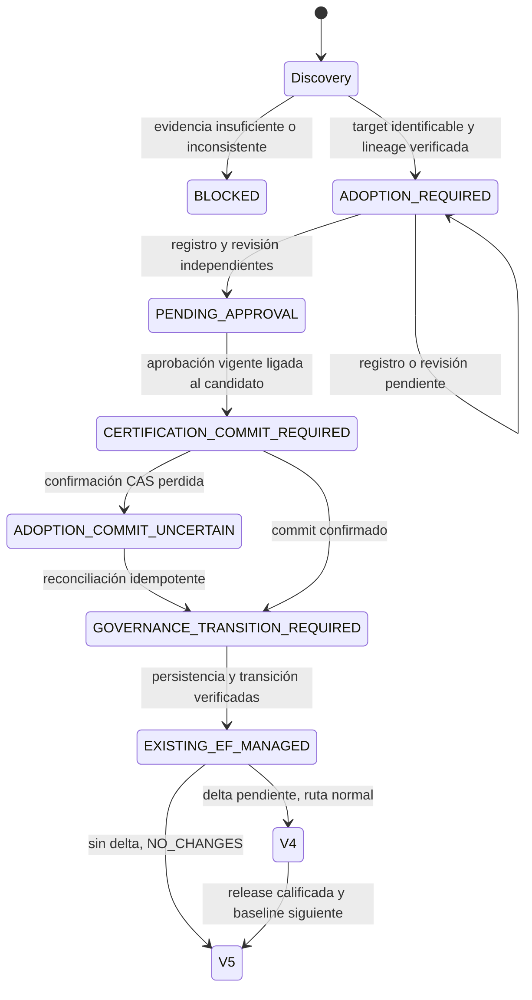

# Adopción inicial EXISTING_EF — contrato complementario V1

Incremento sobre Actions `93f334bcfb0636ca60127607b3300415522650d4` y Workflow
`31ca4412cf663473aef2f83f1b0078238b0e9139`. Este documento describe código en PR;
no acredita integración en main, productores corporativos ni funcionamiento físico.

La barrera anterior era doble: el host exigía MANAGED para EXISTING y el commit
de una release calificada exigía un predecessor certificado. ADOPTION permite
iniciar una evaluación de lectura sin ese predecessor. El commit inicial usa
`BootstrapApproved`; las migraciones posteriores conservan el commit calificado.

Se reutilizan Discovery V2, Repository Discovery V2, `PreSources`, `Observe`, la
validación estructural de History, `DatabaseOnboardingEvaluator`,
`CertificationDecisionEngine`, `CertifiedStateRecordBuilder`,
`CertificationCommitProtocol`, y el motor normal A2.1/PLAN/qualification/POST/baseline.
No se agrega otro motor de rehearsal ni otra clasificación V1–V6.

`EfAdoptionSelectionV1` sólo contiene referencias. El provider registrado por el
host debe autenticar de forma independiente cada rol, scope, repo/revisión, bytes
y vigencia. Los documentos del caller, variables de entorno, hashes o flags no
registran providers ni conceden autoridad. `EfAdoptionPolicyV1` se adquiere dentro
de GOVERNANCE, nunca desde el request como política libre.

La evidencia requiere las cuatro fuentes normalizadas, cobertura completa de
schema/impacto/datos/seguridad, identidad e incarnation, History con columnas/PK/
índice válidos, prefijo aplicado y procedencia del repositorio histórico y actual.
Se adquieren los archivos de cada migración por hash; archivos históricos
modificados bloquean aunque coincidan los nombres. La revisión independiente
liga schema/data/security al source, PRE y lineage exactos. `REVIEW_REQUIRED`
permite revisión humana sustentada; hallazgos sin resolver bloquean. La aprobación
no reemplaza observaciones ni resuelve migraciones desconocidas o divergentes.

El candidato inmutable conserva evidencia completa y ambas revisiones. Su hash
no depende de la aprobación ni de los recibos posteriores. La autorización humana
liga scope, operación, candidato, incarnation, actor y vigencia. Antes del commit
se readquieren source, gobierno y PRE; diferencias en schema, datos, seguridad o
identidad bloquean. Se conserva la igualdad estricta de seguridad sin excepciones
para GRANT/DENY, owners, roles o principals. Cancelación/vencimiento bloquean antes
de persistir. El protocolo existente conserva CAS, idempotencia e incertidumbre.

MANAGED exige record validado con evidencia canónica adquirida por referencia,
pointer actual, receipt committed y transición independiente ligada al baseline,
incarnation y gobierno real MANAGED. Un candidato o una aprobación nunca bastan.
No se escribe Registry. Un registro pendiente se informa como ADOPTION_REQUIRED;
no se transforma en drift/V6. V1–V6 y las políticas NEW_EF no cambian.

`CommitAdoptionAsync` es API de embedding sin store productivo registrado. No es
una operación del CLI ni del workflow. El CLI sólo ofrece ADOPTION de lectura,
publica estado/hashes/diagnóstico sanitizado, y mantiene `executionAuthorized=false`
y `certified=false` incluso cuando informa una certificación adquirida. No publica
el candidato, capturas, datos, seguridad, aprobación, SQL ni un plan ejecutable.

## Matriz offline

Los nombres 01–15 corresponden a `EfAdoptionTests`; cada grupo incluye sus
controles negativos. Los dobles están registrados explícitamente sólo en tests.

| Caso | Evidencia y resultado esperado verificado |
|---|---|
| 1 | Poblada, History válida, sin pendientes: ADOPTION_REQUIRED; tras gobierno V5 |
| 2 | Poblada con pendientes: ADOPTION_REQUIRED; tras gobierno V4 |
| 3 | Record/pointer/receipt/transición válidos: MANAGED V4/V5, sin duplicar baseline |
| 4 | REGISTERED/BASELINE_REQUIRED: revisión faltante → ADOPTION_REQUIRED; completa → PENDING_APPROVAL |
| 5 | Registro pendiente: ADOPTION_REQUIRED/TARGET_REGISTRATION_REQUIRED |
| 6 | Aprobación vigente sin persistencia: CERTIFICATION_COMMIT_REQUIRED, sin MANAGED |
| 7 | Commit inicial simulado y replay: GOVERNANCE_TRANSITION_REQUIRED, un certificado |
| 8 | CAS perdido: ADOPTION_COMMIT_UNCERTAIN; retry reconciliado sin duplicación |
| 9 | Solicitudes concurrentes: un único baseline vigente |
| 10 | Revisión histórica distinta: ambas procedencias y archivos verificados |
| 11 | IDs desconocidos/duplicados/reordenados/eliminados, archivos divergentes: BLOCKED |
| 12 | Drift sin resolver, impacto/datos/metadata incompletos: BLOCKED; sin revisión no hay commit |
| 13 | History ABSENT/EMPTY o columnas/PK/índice inválidos en poblada: BLOCKED |
| 14 | Identidad, incarnation, source/hash/rol, replay, aprobación vencida, cancelación: BLOCKED |
| 15 | Adopción → commit inicial → gobierno → A2.1 V4 → release calificada → segundo baseline → V5 |

Grupos adicionales comprueban Discovery V2 real de archivos → A2.1, recibos y
transiciones manipulados, ausencia de invocaciones al host SQL y CLI real con
factory de test. El consumer Workflow transmite los mismos selectores y valida
los seis estados sanitizados; una aprobación nunca habilita APPLY.

Validación final offline del incremento: build Release sin restore, 0 warnings/
errores; 577 casos/grupos .NET de Qualification (incluyen 19 grupos de adopción
y la regresión del gate compartido); 181 casos/grupos Node Actions (20 del
adaptador, 35 Repository Discovery, 12 clasificación EF, 40 bootstrap read-only,
15 productor y 59 taxonomía NEW_EF); 44 del consumer Workflow. Total funcional
revalidado: 802 PASS, 0 FAIL, sin duplicar reejecuciones. Adicionales: 10 guards,
8 regresiones del guard, DAG real de 152.064 combinaciones con 22 contextos de
source, 8 estados unified y 32 casos de publicación. Los 39 logs del baseline
anterior de 1.264 casos/grupos conservan sus hashes. No se presenta la evidencia
offline como operación corporativa o acreditación SQL física.

## Gates externos y orden de integración

1. Revisión y merge humano de Actions. Obtener su SHA integrado real.
2. Repin controlado del consumer dependiente: checkout Actions, ACTIONS_REVISION,
   UNIFIED_ACTIONS_REVISION, ADOPTION_ACTIONS_REVISION y guard DAG al mismo SHA
   integrado; repetir guards/consumer y revisar el PR Workflow. Sin SHA ficticio.
3. Acreditar host y producers corporativos independientes de observación,
   proyecciones completas, repositorio histórico/actual, revisión/aprobación,
   persistencia y lectura actual de record/pointer/receipt, y transición de gobierno.
   El host productivo devuelve EF_ADOPTION_PRODUCERS_REQUIRED y
   EXECUTED_HOST_ATTESTATION_REQUIRED mientras falten; no acepta fixture por request.
4. Seleccionar infraestructura/store bajo gobierno externo y acreditar durabilidad,
   CAS y recuperación física. Los tests usan únicamente InMemoryCertificationCommitStore.
5. Autorizar separadamente target TEST, credenciales de lectura, capturas físicas,
   aprobación y procedimientos de transición. No se autoriza SQL real, dispatch,
   APPLY, CREATE DATABASE ni cambios de infraestructura en este incremento.

La activación por SHA y la acreditación externa son pendientes explícitos; el
recorrido funcional posible en código y dobles de prueba no requiere otro motor.
